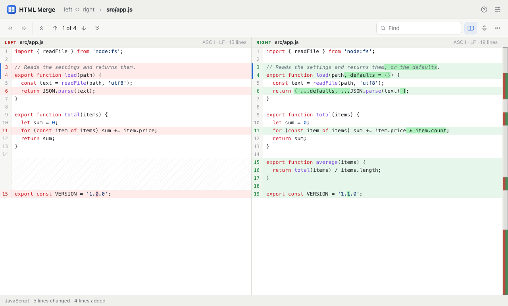

# html-merge

<!-- languages -->
<h3 align="center">
<a href="../../README.md">🇬🇧 English</a> ·
<a href="README.zh.md">🇨🇳 中文</a> ·
<a href="README.hi.md">🇮🇳 हिन्दी</a> ·
<b>🇪🇸 Español</b> ·
<a href="README.fr.md">🇫🇷 Français</a> ·
<a href="README.ar.md">🇸🇦 العربية</a> ·
<a href="README.bn.md">🇧🇩 বাংলা</a> ·
<a href="README.pt.md">🇧🇷 Português</a> ·
<a href="README.ru.md">🇷🇺 Русский</a> ·
<a href="README.ur.md">🇵🇰 اردو</a> ·
<a href="README.id.md">🇮🇩 Bahasa Indonesia</a> ·
<a href="README.de.md">🇩🇪 Deutsch</a> ·
<a href="README.ja.md">🇯🇵 日本語</a> ·
<a href="README.mr.md">🇮🇳 मराठी</a> ·
<a href="README.te.md">🇮🇳 తెలుగు</a> ·
<a href="README.tr.md">🇹🇷 Türkçe</a> ·
<a href="README.uk.md">🇺🇦 Українська</a>
</h3>
<!-- /languages -->

**HTML Merge** compara dos carpetas, o dos archivos, lado a lado — como WinMerge, pero como un
único archivo HTML que funciona en cualquier navegador moderno en Windows, macOS, Linux,
ChromeOS, Android e iOS. Elige dos carpetas y se listan todos los archivos de ambas con lo que
les pasó: idénticos, diferentes, solo a la izquierda, solo a la derecha. Abre un archivo y las
dos versiones se muestran lado a lado, con resaltado de sintaxis para más de cuarenta lenguajes,
las palabras cambiadas marcadas dentro de las líneas cambiadas, y un mapa de todas las
diferencias junto a la barra de desplazamiento.

Solo lee. No se instala nada, no se sube nada y ningún archivo se modifica jamás: los archivos
los lee la propia página, en el navegador, y la página no puede acceder a la red en absoluto.

La misma página también funciona como una PWA (Progressive Web App): servida desde GitHub Pages
se puede instalar en el sistema y entonces se ejecuta como una aplicación aparte, con su propia
ventana e icono, y funciona sin conexión — consulta «[GitHub Pages](#github-pages)».

**Demo en línea: [merge.marketkernel.com](https://merge.marketkernel.com/)**



## Cómo usarlo

1. Compila `build/html-merge.html` (consulta «[Compilación](#compilación)») o tómalo de un
   lanzamiento, y ábrelo en un navegador — abrirlo directamente desde el disco también
   funciona.
2. Elige el lado izquierdo y el derecho: **Carpeta…** o **Archivo…** para cada uno, o arrastra
   una carpeta o un archivo a su casilla. Dos carpetas o dos archivos soltados sobre la ventana
   a la vez se comparan de inmediato.
3. **Comparar**.

Con dos carpetas, aparece la lista de carpetas y se va llenando a medida que se comparan los
archivos. Los chips de arriba muestran u ocultan cada tipo de resultado y los cuentan; la lista
puede ser un árbol o una lista plana de rutas, filtrada por nombre (`util`, o un patrón como
`*.ts`), y ordenada por cualquier columna. Haz doble clic en un archivo (o selecciónalo y pulsa
Intro) para compararlo; `]` y `[` pasan al siguiente y al anterior archivo diferente, y Esc o el
botón Atrás del navegador vuelven a la lista.

En la pantalla de archivo:

- las flechas se mueven entre las diferencias (Alt+↓ y Alt+↑, o F7 y Mayús+F7); la actual se
  marca en el margen, y el mapa de la derecha muestra dónde están todas — haz clic en él para
  saltar;
- **Lado a lado o uno debajo del otro** cambia entre dos paneles y un panel unificado;
- **Plegar líneas idénticas** oculta los tramos idénticos largos, dejando unas pocas líneas
  alrededor de cada diferencia; haz clic en un pliegue para abrirlo;
- **Buscar** (Ctrl+F, ⌘F en un Mac) marca todas las coincidencias en ambos lados; Intro y
  Mayús+Intro se mueven entre ellas;
- el menú **⋯** contiene las opciones de visualización y comparación: la disposición, el
  lenguaje con el que colorear los archivos, los colores de sintaxis, los espacios en blanco y
  los finales de línea visibles, palabras o caracteres dentro de las líneas cambiadas, y qué
  ignorar.

Las imágenes (PNG, JPEG, GIF, WebP, BMP, ICO, AVIF) se muestran lado a lado con su tamaño en
píxeles. Los demás archivos binarios se comparan byte a byte: la página indica si son idénticos,
dónde está la primera diferencia, y muestra los bytes alrededor de ella.

Chrome y Edge recuerdan las comparaciones recientes: se listan en la pantalla de inicio y se
abren de nuevo con un clic (el navegador vuelve a pedir permiso para leer las carpetas). Los
demás navegadores eligen las carpetas de nuevo cada vez.

### En un teléfono

La página funciona en la pantalla de un teléfono: la pantalla de inicio apila los dos lados, la
lista de carpetas conserva el nombre y el resultado, y un par de archivos se muestra uno debajo
del otro. Toca un archivo para abrirlo. En Android, Chrome elige tanto carpetas como archivos;
en iOS se pueden comparar archivos (ahí no se pueden elegir carpetas).

## Funciones

- **Carpetas**: comparación recursiva por contenido (o, más rápido, por tamaño y fecha); un
  árbol o una lista plana; filtros por resultado y por nombre; ordenación por nombre, resultado,
  tamaño o fecha; nombres excluidos por patrón (`.git; node_modules; *.log; build/`); nombres de
  archivo comparados con o sin distinguir mayúsculas de minúsculas; los estados se completan a
  medida que se leen los archivos, unos pocos a la vez, de modo que incluso las carpetas grandes
  muestran algo de inmediato.
- **Texto**: un diff de paciencia sobre el algoritmo de Myers, de modo que las llaves y las
  líneas en blanco movidas no emparejan código sin relación; las líneas de un bloque cambiado se
  emparejan según su parecido; las palabras o caracteres cambiados se marcan dentro de la línea;
  los bloques de líneas en blanco se pueden ignorar; la vista unificada; el plegado de líneas
  idénticas; la búsqueda en ambos lados.
- **Opciones de comparación**: ignorar los cambios de espacios en blanco o todos los espacios en
  blanco, ignorar mayúsculas y minúsculas, ignorar líneas en blanco, ignorar los finales de
  línea (CRLF, LF, CR) — tanto en la lista de carpetas como en la pantalla de archivo.
- **Codificaciones**: UTF-8, UTF-8 con BOM, UTF-16 LE y BE, y Windows-1252 para los archivos que
  no son UTF-8 válido; la codificación, los finales de línea y el número de líneas se muestran
  para cada lado, y una diferencia solo de finales de línea se indica como tal.
- **Resaltado de sintaxis** para más de cuarenta lenguajes, elegido por el nombre del archivo o
  su primera línea (`#!/usr/bin/env python3`): JavaScript, TypeScript, JSON, HTML (con los
  scripts y estilos incluidos), XML, CSS, SCSS, Less, Markdown, Python, Java, Kotlin, C, C++,
  C#, Go, Rust, Swift, Objective-C, PHP, Ruby, shell, PowerShell, archivos batch, SQL, YAML,
  TOML, INI, Dockerfile, Makefile, CMake, diff, Lua, Perl, R, Dart, Scala, Groovy, Haskell,
  Elixir, GraphQL, Protocol Buffers, Pascal, Visual Basic. Cualquier otro lenguaje se puede
  elegir a mano.
- **Archivos grandes**: solo se dibujan las líneas visibles, de modo que los archivos de cientos
  de miles de líneas se desplazan con fluidez; las líneas muy largas se recortan en pantalla (la
  comparación sigue viéndolas por completo).
- **Imágenes y archivos binarios** como se describió arriba.
- **Diecisiete idiomas** de la interfaz, de derecha a izquierda para árabe y urdu; un tema claro
  y uno oscuro que siguen el sistema o se eligen.
- La aplicación instalada se actualiza solo cuando se le pide: consulta
  «[GitHub Pages](#github-pages)».

## Atajos de teclado

| Teclas | Acción |
| --- | --- |
| Alt+↓, F7 | Siguiente diferencia |
| Alt+↑, Mayús+F7 | Diferencia anterior |
| `]` / `[` | Siguiente / anterior archivo diferente |
| Ctrl+F (⌘F) | Buscar en los archivos, o filtrar la lista de carpetas |
| Intro / Mayús+Intro | Siguiente / anterior coincidencia |
| ↑ ↓ ← → | Moverse por la lista de carpetas, abrir y cerrar carpetas |
| Intro | Abrir el archivo seleccionado |
| Esc | Volver a la lista de carpetas |
| F5 | Comparar de nuevo |
| ? | La lista de atajos |

## Seguridad

- **Solo lectura.** La página lee los archivos y nunca escribe, renombra ni elimina nada. En
  Chrome y Edge las carpetas se abren mediante la File System Access API con acceso solo de
  lectura.
- **Sin conexión por diseño.** La Content-Security-Policy de la página dice
  `connect-src 'none'`, y todo lo que necesita — estilos, código, iconos — está dentro del único
  archivo HTML. No puede cargar nada ni enviar nada, sea lo que sea que contenga un archivo
  comparado.
- **Script fijado.** La compilación sustituye `script-src 'unsafe-inline'` por el hash del único
  script de la página: si alguna vez un nombre de archivo o una línea de texto se colara sin
  escapar, un controlador en línea dentro de él aun así no se ejecutaría. El texto de los
  archivos llega a la página escapado.
- Las comparaciones recientes (Chrome y Edge) guardan solo los identificadores de carpeta en el
  IndexedDB del navegador — sin nombres de archivo dentro, sin contenido. La configuración se
  guarda en `localStorage`.

## Traducciones

La interfaz está en inglés, chino, hindi, español, francés, árabe, bengalí, portugués, ruso,
urdu, indonesio, alemán, japonés, maratí, telugu, turco y ucraniano. Empieza en el primero de
los idiomas del navegador que conoce; Configuración → Idioma elige otro.

- El inglés vive en el código: `t('context', 'English text')`, o
  `tn('context', '{count} file', '{count} files', n)` para un texto con un número. En
  `src/app/template.html` lo mismo es `data-i18n="context"` (el texto del elemento) y
  `data-i18n-attr="context"` (su title, placeholder y aria-label).
- Cada uno de los demás idiomas es un diccionario, `src/locales/<code>.json`:
  `{ "context": { "English text": "translation" } }`. Un texto con un número tiene una forma
  por cada categoría plural del idioma (`Intl.PluralRules`), con la forma plural en inglés como
  clave.
- Lo que falte en un diccionario se muestra en inglés.
- `npm run i18n` imprime, por idioma, las cadenas que le faltan a su diccionario y las que tiene
  y que la interfaz ya no usa; `npm test` comprueba los marcadores de posición y las formas
  plurales.

## Compilación

Necesita Node.js 20 o más reciente.

```sh
npm install
npm run build        # build/html-merge.html y build/pages/
npm run watch        # recompila con cada cambio
npm run check        # comprobación de tipos, pruebas unitarias, compilación, pruebas de navegador
```

`./build.sh` hace lo mismo que `npm run build`, instalando las dependencias en la primera
ejecución. Las únicas dependencias son esbuild y TypeScript, ambas para compilar; la página en
sí no usa ninguna biblioteca.

- `npm test` ejecuta las pruebas unitarias en Node: el diff, las filas y el plegado, las
  codificaciones, el resaltador y sus gramáticas, la comparación de carpetas, los diccionarios.
- `npm run test:browser` controla la página compilada y la PWA en un Chrome sin interfaz,
  mediante el protocolo DevTools, sin ninguna otra dependencia. Necesita un Chrome o Chromium
  local (`CHROME=/path/to/chrome` para elegir uno) y se omite si no hay ninguno.
- `npm run shots -- <dir>` guarda capturas de pantalla de cada pantalla principal.
- `npm run icons` genera los iconos PNG de la PWA a partir de `assets/icon.svg`.

## Versiones y lanzamientos

La versión vive solo en `package.json`. Una compilación del commit etiquetado `v<version>` la
muestra tal cual; cualquier otra compilación añade su commit (`0.1.0+1a2b3c4`), de modo que una
página compilada desde `main` no se confunde con un lanzamiento. La versión se muestra al pie de
la pantalla de inicio y en Configuración.

Para publicar un lanzamiento: `npm version minor` (o `patch`), y luego
`git push --follow-tags`. La etiqueta inicia `.github/workflows/release.yml`, que comprueba que
la etiqueta coincide con `package.json`, ejecuta las pruebas y adjunta
`html-merge-v<version>.html` y `SHA256SUMS.txt` al lanzamiento de GitHub.

## GitHub Pages

Este repositorio está publicado en <https://merge.marketkernel.com/>.

`build/pages/` es la misma página como una PWA instalable: un manifest, iconos y un service
worker que la mantiene funcionando sin conexión. `.github/workflows/pages.yml` la compila, la
prueba y la despliega en GitHub Pages en cada push a `main` (Settings → Pages → Source: GitHub
Actions). Todas sus rutas son relativas, así que funciona bajo la dirección `/<repo>/` de un
sitio de proyecto.

- La CSP de la PWA añade solo su propio origen para el manifest, el worker y los iconos;
  `connect-src` sigue siendo `'none'`.
- Un nuevo despliegue no reemplaza la versión en ejecución por sí solo: el nuevo service worker
  espera, y Configuración (y la pantalla de inicio) dicen «La versión X está lista.
  Actualización». La página lo comprueba discretamente cada seis horas y cuando vuelve la
  conexión.
- Después de una actualización, se dice una vez «Actualizado a la versión X».

## Estructura

```text
build.mjs              la compilación: el archivo único y build/pages/
src/core/diff.ts       opciones de comparación, claves de línea, diff de paciencia sobre Myers, hunks
src/core/inline.ts     palabras o caracteres cambiados dentro de una línea, emparejando las líneas de un bloque
src/core/rows.ts       filas y bloques; la vista: lado a lado o unificada, pliegues
src/core/text.ts       binario o texto, codificaciones, líneas y finales de línea, columnas
src/core/highlight.ts  el tokenizador: estados de expresiones regulares sticky
src/core/languages.ts  las gramáticas, y en qué lenguaje está un archivo
src/core/folder.ts     dos árboles fusionados, estados, los filtros y el orden de la lista, patrones de exclusión
src/core/format.ts     tamaños, fechas y números en el idioma de la interfaz
src/core/i18n.ts       t(), tn(), los diccionarios, traduciendo el marcado de la página
src/app/template.html  la página, con su Content-Security-Policy
src/app/styles.css     los estilos, el tema claro y el oscuro, los colores de sintaxis
src/app/main.ts        la pantalla de inicio, la comparación de carpetas, las pantallas, el historial, las teclas, arrastrar y soltar
src/app/folderview.ts  la lista de carpetas: filas virtuales, chips, filtro, ordenación, teclas
src/app/filescreen.ts  la pantalla de archivo: barra de herramientas, encabezados, línea de estado, opciones
src/app/diffview.ts    los paneles de texto: filas virtuales, palabras, colores, mapa, búsqueda, pliegues
src/app/mediaview.ts   imágenes lado a lado, archivos binarios como bytes
src/app/sources.ts     selectores de carpeta y archivo, elementos soltados, lectura de archivos
src/app/recent.ts      comparaciones recientes: identificadores en IndexedDB
src/app/settings.ts    configuración en localStorage, tema, tamaño de texto
src/app/settingsview.ts el diálogo de configuración, los atajos, las opciones de comparación compartidas
src/app/ui.ts          elementos, iconos, diálogos, popovers, notificaciones, escapado
src/app/update.ts      actualizaciones de la aplicación instalada
src/pwa/sw.js          el service worker de la PWA
src/locales/*.json     los 16 diccionarios
tools/                 load.mjs (src/ para Node), chrome.mjs (Chrome sin interfaz), i18n.mjs, shots.mjs, icons.mjs
tests/                 pruebas unitarias en Node; app.mjs y pwa.mjs en Chrome
```

## Limitaciones

- **Solo lectura por diseño**: no hay fusión ni edición; copia los cambios en tu editor.
- Firefox y Safari eligen carpetas con el diálogo de subida de carpetas del navegador: lee toda
  la carpeta de una vez (los nombres excluidos se descartan después, no se omiten), no muestra
  las carpetas vacías, y una actualización no ve los archivos añadidos después de eso — para eso
  hay que volver a elegir las carpetas. iOS no puede elegir carpetas en absoluto.
- Los archivos de más de 64 MB se comparan solo byte a byte, sin las opciones de ignorar.
- El resaltado de sintaxis es léxico — palabras clave, cadenas, comentarios, números — no un
  analizador sintáctico; algunas construcciones (etiquetas JSX, heredocs) se colorean como texto
  plano.
- Sin comparación de tres vías, sin comparación del contenido de archivos comprimidos, sin
  detección de bloques movidos.

## Licencia

MIT — consulta [LICENSE](../../LICENSE).
